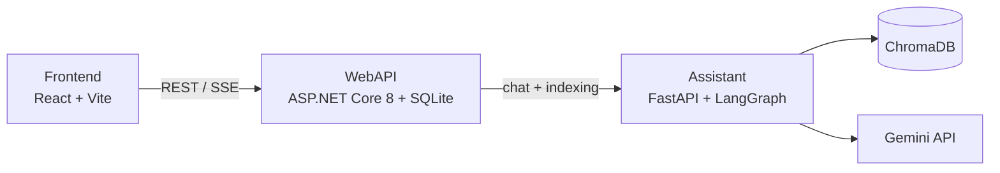

# Knowledge Assistant

A local RAG (Retrieval-Augmented Generation) chat app. Admins upload documents (PDF, TXT, Markdown) or paste text, and users chat with an assistant that answers using that knowledge base.

> Status: personal portfolio project. Source citations are not implemented yet.

## Features

- Login with JWT (admin and normal users)
- Streaming chat with saved conversation history
- Admin panel to manage users and documents
- Documents are chunked, embedded and stored in ChromaDB, then retrieved by semantic search when answering
- Temporary text/Markdown attachments in chat (used for that request only)

## How it works



- **Frontend**: login, chat, history sidebar, admin panel.
- **WebAPI**: auth, chat history and document records (SQLite), plus a background worker that sends documents to the Assistant for indexing.
- **Assistant**: embeds documents, searches ChromaDB, and streams answers from Gemini.

## Tech stack

React 19, TypeScript, Vite, ASP.NET Core 8, EF Core, SQLite, Python, FastAPI, LangGraph, ChromaDB, Google Gemini

## Quick install

### Prerequisites
- Node.js 20+
- .NET SDK 8
- Python 3.10 - 3.12
- A [Gemini API key](https://aistudio.google.com/)

Start the services in order (each in its own terminal):

### 1. Assistant (Python AI Service - port 8000)

```bash
cd Assistant
python -m venv .venv
# Windows (PowerShell): .\.venv\Scripts\Activate.ps1
# Linux/macOS:          source .venv/bin/activate

pip install -r requirements.txt
cp .env.example .env   # On Windows PowerShell: Copy-Item .env.example .env
```

Configure your custom AI-service values in `Assistant/.env` (this file is local-only and must not be committed):

```dotenv
GEMINI_API_KEY=your-gemini-api-key
ASSISTANT_INTERNAL_KEY=choose-a-private-shared-key
```

You can also customize `GEMINI_MODEL`, `EMBEDDING_MODEL`, `CHROMA_PERSIST_DIR`,
`ASSISTANT_HOST`, `ASSISTANT_PORT`, and `LOG_LEVEL` in the same file. Keep the
variable names from `Assistant/.env.example` and replace only their values.

Start the server:
```bash
uvicorn main:app --port 8000 --reload
```

### 2. WebAPI (ASP.NET Core - port 5090)

WebAPI settings are configured through ASP.NET Core environment variables. Set
custom values before starting the API; use double underscores (`__`) for nested
settings:

```powershell
$env:ConnectionStrings__DefaultConnection = "Data Source=knowledge_assistant.db"
$env:AssistantService__BaseUrl = "http://localhost:8000"
$env:AssistantService__InternalKey = "choose-the-same-key-as-ASSISTANT_INTERNAL_KEY"
$env:Frontend__Origin = "http://localhost:5173"
$env:Jwt__SecretKey = "generate-a-long-random-secret"
$env:AdminSeed__Username = "admin"
$env:AdminSeed__Password = "choose-a-strong-password"
dotnet run
```

On macOS/Linux, use `export NAME=value` instead of `$env:NAME = value`.
These variables override values in `WebAPI/appsettings.json`, so do not put
real API keys, passwords, or signing keys in that file. The internal key must
match `ASSISTANT_INTERNAL_KEY` in `Assistant/.env`. For repeatable local setup,
put the PowerShell values in your local shell profile or use the .NET user
secrets store; do not commit a secrets file.

```bash
cd WebAPI
dotnet run
```

> **Note:** On first startup, SQLite database migrations are applied automatically, and a default admin account is seeded using `AdminSeed__Username` and `AdminSeed__Password`. Swagger UI is available at `http://localhost:5090/swagger`.

### 3. Frontend (React + Vite - port 5173)

```bash
cd Frontend
npm install
npm run dev
```

The frontend connects to WebAPI at `http://localhost:5090` by default. To use a
custom API URL, create `Frontend/.env.local` and add:

```dotenv
VITE_API_BASE_URL=http://localhost:5090
```

Open [http://localhost:5173](http://localhost:5173). Do not put private keys or
passwords in `Frontend/.env.local`; Vite exposes `VITE_*` values to the browser.

---

### First-time login & usage

1. **Log in with the seeded admin account**:
   - Use the values you set with `AdminSeed__Username` and `AdminSeed__Password`.
   - Set the password before the first WebAPI startup; changing it later does not
     change an account that has already been created.
2. **Upload documents**: Navigate to **Admin Panel** to upload `.pdf`, `.txt`, or `.md` files. The background worker will extract, chunk, and index them into ChromaDB.
3. **Start chatting**: Create a conversation and ask questions based on the ingested knowledge base.


## Project structure

```text
Assistant/   Python AI service (LangGraph, Gemini, ChromaDB)
WebAPI/      ASP.NET Core gateway (auth, chat history, documents, ingestion worker)
Frontend/    React client
```

## Tests

```bash
cd Assistant && pytest -v tests/
cd Frontend && npm run lint && npm run build
```

The WebAPI has no test project yet.

## Known limitations

- No source citations in answers
- Scanned PDFs (no extractable text) can't be indexed
- No Docker setup yet
